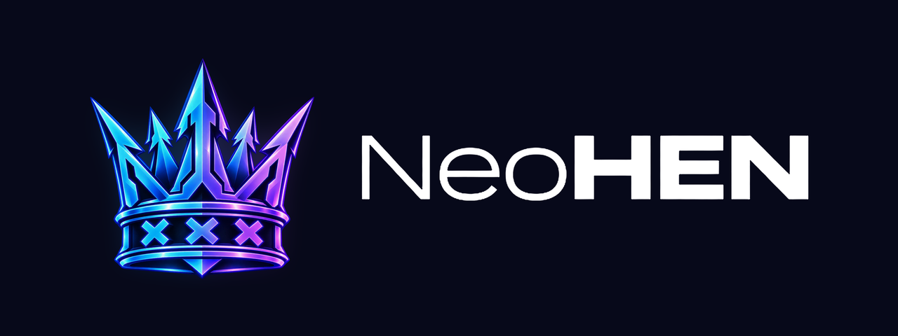

<p align="center">
  
</p>

<p align="center">
  <a href="README.md">English</a> · <b>Español</b>
</p>

# NeoHEN

NeoHEN es un habilitador de homebrew con Toolbox para consolas PS5 con
jailbreak. Se envía un solo fichero tras el exploit, `NeoHEN.elf`, y la
consola queda lista: Toolbox en el menú de inicio, montador de juegos, FTP,
DNS y NeoWEB, una página web y servicio remoto en la consola. Todo lo que
arranca va dentro de ese fichero; no hay nada que instalar.

Es un fork de [OnionHEN](https://github.com/aydencharles/onionHEN), de
aydencharles y colaboradores, que a su vez está construido sobre
[etaHEN](https://github.com/etaHEN/etaHEN), de LightningMods y colaboradores.
Casi todo lo que hace la Toolbox es trabajo suyo. NeoHEN añade las piezas de
la tabla de abajo y arregla lo que falló en la consola de su autor. Licencia
GPLv3.

> **Estado: 1.0.0, primera versión estable.** NeoHEN se ha ejecutado en
> una única PS5 (CFI-7021, firmware 13.42). Todo lo que sigue indica si se
> vio funcionar ahí o si solo está compilado. Lo nuevo desde la 0.1.0-rc13
> está compilado para PS5 en CI y probado en un PC, todavía no en consola.
> Úsalo en una consola que puedas permitirte reiniciar.

## Qué cambia NeoHEN respecto a OnionHEN

| Área | NeoHEN |
|---|---|
| Reposo | La Toolbox vuelve sola cuando el menú lleva 30 s estable. El original la reinyecta a los 10 s de despertar, y en 13.42 eso reiniciaba el menú y lo dejaba bloqueado cerca de un minuto. Tres modos: `stable` (por defecto), `manual` y `original`. |
| Un solo fichero | `NeoHEN.elf` lleva dentro kstuff-lite, ShadowMount+, ftpsrv, nanoDNS, NeoWEB y el servicio de temas. En el primer arranque los escribe en `/data/neohen/payloads` y los lanza en orden; en los siguientes, solo los lanza. No hay que descargar, copiar ni renombrar nada. |
| Tú decides | Un payload que sustituyas o borres se queda como lo dejaste. Un `kstuff.elf` en `/data/neohen/` sustituye al que va dentro, y si ya hay un kstuff en marcha no se toca. |
| ShadowMount+ | Se usa el payload de su autor sin modificar, con un vigilante que comprueba su hook tras el reposo y cada minuto, y puede relanzarlo. |
| NeoWEB | Página web y servicio HTTP en la consola (puerto 8686), sin app en el PC: panel, biblioteca, payloads, ficheros, Instalar (PKG mediante ShadowMount+), tienda de apps, temas, homebrew, ajustes y actualizaciones de NeoHEN. Ver [web/README.md](web/README.md). |
| Actualizaciones | Desde la 0.1.0-rc16, NeoHEN se actualiza desde NeoWEB (SHA-256 comprobado, se guarda la versión anterior, vuelta atrás). También sirve enviar un `NeoHEN.elf` nuevo con el viejo en marcha. |
| Robustez | Modo seguro tras arranques fallidos, vigilante de NeoWEB, avisos de conflictos e informe de diagnóstico. Ver [docs/robustness.md](docs/robustness.md). |
| Privacidad | Los logs nunca llevan el nombre ni el identificador de la cuenta, y las IP y MAC se sustituyen. Los del original escriben nombre e identificador cada vez que se abre un menú. |
| Partición del sistema | El icono de la Toolbox vive en memoria volátil en vez de escribirse en `/system_ex`. |
| Valores seguros | Lo no verificado en 13.42 va oculto o apagado: superposición en partida, instalación de PKG desde la Toolbox, cargador de SPRX por juego, app jailbreak. |
| Marca | Nombre, rutas (`/data/neohen`), iconos y entrada de Ajustes, hechos con variables de compilación para que el fork siga pudiendo sincronizarse con el original. |
| Herramienta de PC | `neohen_pc` (rama `neohen/pc-tool`): comprueba la carpeta de un juego y la empaqueta como `.ffpfsc`, `.ffpfs`, `.exfat` o `.ffpkg`. |

El resto es OnionHEN: la Toolbox en 29 idiomas, trucos (JSON, SHN, MC4,
ShnExt), plugins, gestor de payloads, control del ventilador, emparejamiento
de Uso a distancia, atajos y opciones de juego. Su documentación está en
[docs/README-OnionHEN.md](docs/README-OnionHEN.md).

## Firmware

NeoHEN 1.0 apunta a los firmware **13.00 a 13.60**. Solo se ha probado el
**13.42**, en una consola. Los demás figuran como «por confirmar» hasta que
alguien los pruebe y lo cuente (abre una incidencia con el firmware, el
punto de entrada que usaste y `/data/neohen/NeoHEN.log`). 14.x no está
soportado.

| Firmware | Arranque | FPKG con ShadowMount+ | Reposo | Trucos | NeoWEB |
|---|---|---|---|---|---|
| **13.42** (CFI-7021) | Funciona (rc1; en frío, rc2) | Imágenes montadas (`.ffpfsc`, una AMPR) funcionan (rc1); instalar PKG sin confirmar | Funciona con un juego suspendido, `manual` y `stable` (rc1); un reposo de 29 h en la rc2 encontró dos fallos, corregidos en la rc3 | Descarga del catálogo funciona (rc1); listar y activar desde NeoWEB probado (desarrollo de la rc5); aplicar un truco en un juego sin confirmar | Estado, biblioteca, carátulas y gestor de payloads funcionan (rc3); partes de la variante completa probadas (desarrollo de la rc5); lanzar/cerrar un juego sin probar |
| 13.00 | Por confirmar | Por confirmar | Por confirmar | Por confirmar | Por confirmar |
| 13.20 | Por confirmar | Por confirmar | Por confirmar | Por confirmar | Por confirmar |
| 13.40 | Por confirmar | Por confirmar | Por confirmar | Por confirmar | Por confirmar |
| 13.60 | Por confirmar | Por confirmar | Por confirmar | Por confirmar | Por confirmar |
| Anteriores a 13.00 | Debería funcionar, sin probar | Debería funcionar, sin probar | Debería funcionar, sin probar | Debería funcionar, sin probar | Debería funcionar, sin probar |
| 14.00 y posteriores | Sin soporte | — | — | — | — |

Las filas 13.xx son los firmware para los que el kstuff-lite 1.11 incluido
trae offsets del kernel (los trae de 1.00 a 13.60). «Debería funcionar»
solo significa que nada de NeoHEN depende de 13.xx; que llegue a arrancar
depende de tu punto de entrada y de kstuff. Los resultados detallados en
13.42 están en la sección siguiente.

## Qué se ha probado

En una PS5 CFI-7021, firmware 13.42, con kstuff-lite 1.11 y ShadowMount+
1.7beta2 y, desde el 2026-10-07, 1.7beta4.

| | Resultado |
|---|---|
| Arranque, Toolbox desde la tarjeta de inicio y desde Ajustes | Funciona (0.1.0-rc1) |
| Icono nuevo servido desde memoria volátil | Funciona (0.1.0-rc1) |
| Descarga del catálogo de trucos (6.231 ficheros) | Funciona (0.1.0-rc1) |
| Juegos montados por ShadowMount+ (`.ffpfsc`, uno de ellos AMPR) y homebrew | Funcionan (0.1.0-rc1) |
| Reposo con un juego suspendido, modos `manual` y `stable` | Funciona (0.1.0-rc1) |
| Recargar la Toolbox desde un PC (`neohen_ctl.py toolbox`) | Funciona (0.1.0-rc1) |
| Pasar desde un OnionHEN en marcha sin reiniciar | Funciona (0.1.0-rc1) |
| NeoWEB: estado, sensores, discos, biblioteca, carátulas, juego abierto | Funciona |
| Arranque en frío: kstuff incrustado, Toolbox, los cuatro payloads arrancados solos, un juego | Funciona (0.1.0-rc2, payloads copiados a mano) |
| "NeoHEN Toolbox" en Ajustes, `stable` por defecto | Funciona (0.1.0-rc2) |
| Página web de NeoWEB con sus tres pestañas, escritorio y móvil | Funciona |
| Gestor de payloads de NeoWEB: enviar, arrancar, parar, borrar, autoarranque | Funciona (0.1.0-rc3) |
| **Primer arranque instalando los payloads desde dentro del ELF** | **Compilado, sin probar en consola** |
| NeoWEB: lanzar y cerrar un juego | **Sin probar** |
| El vigilante relanzando un ShadowMount+ parado (`watchdog=relaunch`) | Funciona (0.1.0-rc2) |
| NeoWEB reabriendo su puerto tras el reposo | **Compilado, sin probar con un reposo real** |
| El vigilante de ShadowMount+ recuperando un hook perdido, y esperando al juego abierto | **Sin probar** |
| Aplicar un truco, instalar PKG, superposición, app jailbreak | **Sin probar** |
| Cualquier firmware distinto de 13.42 | **Sin probar** |

Anotado después en los mensajes de commit (13.42, durante el desarrollo de
la 0.1.0-rc5): se probaron en consola los trofeos, las listas de juegos y
arreglos, listar y activar trucos, la velocidad y reanudación de subidas, el
panel de ShadowMount+, montar/ver/desmontar y la página de juego; los iconos
de menú de los temas se comprobaron en la rc12. De la rc13 en adelante aún
no hay ningún resultado en consola anotado.

## Versiones

Versión actual: **1.0.0**. Las versiones anteriores y el texto de estado de
antes están en [docs/CHANGELOG.md](docs/CHANGELOG.md); las notas de la
1.0.0, en [docs/release-notes-1.0.md](docs/release-notes-1.0.md).

- **1.0.0** — primera versión estable: todo lo de la 0.1.0-rc15 y la rc16,
  más OffAct y los zips de homebrew en la tienda, el interruptor «Bloquear
  actualizaciones del sistema» de nanoDNS, un `autoload.txt` para el
  autoloader unificado en el zip y los textos de licencia en el zip.
- **0.1.0-rc16** (sin publicar) — NeoHEN se actualiza desde NeoWEB:
  SHA-256 comprobado, se guarda la versión anterior, vuelta atrás automática
  tras dos arranques fallidos, vuelta atrás a mano, y el ajuste «usar la
  actualización al arrancar», apagado por defecto. NeoWEB: lanzador de
  homebrew con la estructura de websrv, duplicados y restos en la
  biblioteca, pestaña de ajustes de NeoHEN con copia y restauración, token
  de invitado (solo lectura), código QR dibujado sin internet, manejo con el
  mando en el navegador de la PS5, instalable como app en el móvil (PWA) y
  una aurora del tema «Console» más ligera. Tienda: ps5debug-NG, PS5SX2 y
  ProsperoEden.
- **0.1.0-rc15** (sin publicar) — un solo archivo `VERSION`,
  `update.channel` (estable / pre-release), CI reproducible (SDK y
  dependencias fijados por SHA-256), arreglos de seguridad de la revisión
  de la 1.0 (entre otros, cualquier web de la red podía usar la API de
  NeoWEB), NeoWEB comprimido y más rápido, SHA-256 obligatorio en la tienda,
  ajuste del vigilante de NeoWEB, modo seguro, avisos de conflictos e
  informe de diagnóstico más completo.
- **0.1.0-rc14** (publicada el 2026-11-04) — vigilante de NeoWEB tras el
  reposo y log propio de NeoWEB, ShadowMount+ 1.7beta11 (carpetas SMB,
  expulsión de USB, una sola cola de instalación), carpetas SMB y
  descompresión de archivos en NeoWEB, test de red, la tienda leyendo en
  directo el catálogo de ProsperoStore, y OnionHEN main del 2026-10-30.
- **0.1.0-rc13** (2026-10-26) — ShadowMount+ 1.7beta8, OnionHEN v0.9.0,
  sección Instalar (PKG, parches, DLC, backports) y tienda de apps en
  NeoWEB 0.8.0, y el arreglo de elfldr v0.27 en el cargador incrustado.

Problemas conocidos: la detección del conflicto con ps5upload no consigue
decidir en 13.42 (escribe `tracer state unknown`), así que no uses ps5upload
junto con la Toolbox; y el autopausado de kstuff de ShadowMount+ indica que
kstuff ya estaba desactivado, por una causa aún sin identificar.

## Descarga

**[Releases](../../releases)** — descarga `NeoHEN.elf` de la última, o el
`NeoHEN-<versión>.zip` que lo trae junto a `LEEME.txt` (guía más completa),
`TERCEROS.txt` (software de terceros), `neohen_ctl.py`, un `config.ini` de
ejemplo y una carpeta `autoload/` para autocargadores. Hasta la 1.0 todas son versiones preliminares.

GitHub Actions compila además cada rama; los artefactos están en la pestaña
[Actions](../../actions) (GitHub pide haber iniciado sesión). Están
compilados, no verificados en consola.

## Instalación

No hay instalación como tal: `NeoHEN.elf` se envía a la consola en cada
arranque y se prepara solo la primera vez.

### 1. Lanza un punto de entrada

Hace falta una cadena de exploits (userland y kernel) que deje un cargador
de ELF escuchando en el **puerto 9021**. NeoHEN no trae ninguno y este
README no explica cómo lanzarlos; sigue su propia documentación. Algunos
puntos de entrada habituales:

- Relapse (cadena WebKit y kernel);
- [PS5 Lua Autoloader](https://github.com/itsPLK/ps5-lua-autoloader), que
  puede cargar payloads por sí solo;
- [Y2JB](https://github.com/Gezine/Y2JB) (app de YouTube);
- BD-JB, por ejemplo [BD-UN-JB](https://github.com/Gezine/BD-UN-JB).

El cargador del 9021 suele ser
[elfldr](https://github.com/ps5-payload-dev/elfldr), de ps5-payload-dev.
Elige uno que soporte tu firmware; ver [Firmware](#firmware).

### 2. Envía NeoHEN.elf al puerto 9021

De cualquiera de estas formas:

- **Desde un PC** de la misma red, con cualquier programa que envíe ELF,
  por ejemplo `socat -u FILE:NeoHEN.elf TCP:<IP_PS5>:9021` o
  `nc -N <IP_PS5> 9021 < NeoHEN.elf` (netcat de OpenBSD; otros usan
  `-q 0`). `scripts/neohen_ctl.py` no envía ELF: habla con un NeoHEN que ya
  está en marcha (puerto 9048), ver [Configuración](#configuración).
- **Desde un cargador que carga payloads solo**: añade `NeoHEN.elf` a su
  lista como diga su documentación, y NeoHEN arrancará solo tras el exploit.
  La carpeta `autoload/` del zip trae un `autoload.txt` listo para los
  autocargadores de itsPLK (ver `autoload/LEEME.txt` en el zip).

No cargues a la vez etaHEN, OnionHEN ni CheatRunner (NeoHEN se niega a
arrancar junto a algunos y avisa de otros).

### 3. Primer arranque

NeoHEN arranca, en este orden: kstuff (salvo que ya haya uno), su cargador
privado en el puerto 9020, la Toolbox en el menú y luego los payloads
incluidos. La primera vez crea `/data/neohen` en la consola:

| Ruta | Qué |
|---|---|
| `payloads/` | `shadowmountplus.elf`, `ftpsrv.elf`, `nanodns.elf`, `neoweb.elf`, `neotheme.elf`, cada uno con `.auto_start` (arrancarlo), `.json` (orden) y `.bundled` (lo puso NeoHEN) |
| `config.ini` | no se crea; NeoHEN usa sus valores por defecto hasta que escribas uno (el zip trae `config.ini.ejemplo`) |
| `web/` | `config.json` de NeoWEB (token, token de invitado) y su log `neoweb.log` |
| `themes/` | el tema incluido «Neon Tide Basic», en una consola que no tenga ninguno |
| `update/` | solo tras una actualización desde NeoWEB |
| `NeoHEN.log`, `NeoHEN_crash.log`, `NeoHEN_util_daemon.log` | logs (sin nombre ni ID de cuenta; IP y MAC sustituidas) |

La instalación de los payloads en el primer arranque está compilada y
revisada, pero no se había ejecutado en consola la última vez que se anotó
(ver la tabla de pruebas). Si faltan los payloads, cópialos a mano en
`/data/neohen/payloads` y abre una incidencia con `NeoHEN.log`.

La Toolbox se abre desde la tarjeta «N» de la fila superior del menú de
inicio o desde Ajustes.

**NeoWEB.** Al arrancar, la consola muestra su dirección,
`http://<IP_PS5>:8686`. Ábrela en cualquier navegador de la misma red, o
desde el icono de NeoWEB que NeoWEB pone en Multimedia. Para abrirla en el
móvil usa el código QR (acción rápida «En el móvil» del panel, o Ajustes >
Acceso); lo dibuja la propia página, sin internet.

**Acceso.** Por defecto NeoWEB **no tiene contraseña**: cualquiera de tu red
puede usarla, el mismo acceso que ya da el cargador del puerto 9021. En
Ajustes > Acceso puedes crear un token (se muestra una sola vez; el QR y los
enlaces lo llevan) y un **token de invitado** que solo puede consultar
(estado, biblioteca, carátulas, lista de payloads, trofeos, capturas; nada
que cambie algo). El fichero vacío `/data/neohen/web/readonly` apaga todas
las rutas que modifican algo. Ver
[web/README.md](web/README.md#token-and-guest-link).

**Tus payloads.** Por FTP (ftpsrv), en `/data/neohen/payloads`:

- No arrancar uno: borra su fichero `.auto_start`.
- Quitar uno: borra su `.elf`. No vuelve a instalarse.
- Usar otra versión: sustituye el `.elf` y borra su fichero `.bundled`.
- Otro kstuff: deja un `kstuff.elf` en `/data/neohen/`.

Dentro de `NeoHEN.elf`, sin modificar:

| Payload | Versión | Licencia |
|---|---|---|
| [ShadowMount+](https://github.com/drakmor/ShadowMountPlus) | 1.7beta11 | GPL-3.0 |
| [ftpsrv](https://github.com/ps5-payload-dev/ftpsrv) | v0.21.1 | GPL-3.0 |
| [nanoDNS](https://github.com/drakmor/nanoDNS) | 0.4 | GPL-3.0 |
| [kstuff-lite](https://github.com/EchoStretch/kstuff-lite) | v1.11 | sin declarar |

Los tres primeros están fijados por URL y SHA-256 en
`scripts/release/payloads.lock`. NeoWEB y el servicio de temas son de
NeoHEN (GPL-3.0). Todos los componentes incluidos, con su licencia, están
en [docs/third-party-licences.md](docs/third-party-licences.md).

### Actualizar

- **Desde NeoWEB, con un clic** (0.1.0-rc16 en adelante): Sistema >
  Actualizar NeoHEN busca en GitHub la versión que elige tu
  `update.channel` (`stable` por defecto), la descarga, exige y comprueba
  el SHA-256 de GitHub, mira el espacio libre, valida los ficheros y la deja
  en `/data/neohen/update/current` junto a la anterior. Solo se pueden
  instalar así versiones de la 0.1.0-rc16 en adelante.
- **Cuándo se usa.** «Reiniciar NeoHEN con …» la arranca en el momento (no
  con un juego abierto; el menú se reinicia). Al arrancar la consola decide
  el ajuste **Usar la actualización al arrancar** (`update.apply_at_boot`):
  **apagado, por defecto**, arranca el `NeoHEN.elf` que envías, así que
  actualiza también la copia que manda tu cargador; **encendido**, cada
  arranque pasa a la versión instalada si es más nueva que la enviada, y
  una versión que no termina de arrancar dos veces seguidas vuelve sola a
  la anterior.
- **Volver atrás.** «Volver a la anterior» en la misma tarjeta, a partir del
  siguiente arranque. Por FTP: borra `/data/neohen/update/current` y
  `update/state.json`; entonces arranca el `NeoHEN.elf` que envíes.
- **A mano.** Manda el `NeoHEN.elf` nuevo al 9021 con el viejo cargado. El
  nuevo para al anterior (como `neohen_ctl.py shutdown`), espera a que
  vuelva el menú y arranca. kstuff no se carga dos veces, y los payloads
  incluidos se cambian si su versión es otra (ShadowMount+ solo sin juego
  abierto). Con un juego abierto no cambia nada: pide cerrarlo y volver a
  mandarlo.

Detalles: [docs/robustness.md](docs/robustness.md#neohen-update-and-rollback).

### Modo seguro

Si NeoHEN no termina de arrancar **3 veces seguidas**, arranca en modo
seguro: sin payloads automáticos salvo NeoWEB, sin plugins ELF y sin plugins
SPRX en los juegos. A las 5 se deja fuera también NeoWEB. Lo dicen una
notificación y el panel de NeoWEB; el botón **Arranque normal** del panel lo
quita. kstuff, la Toolbox, el daemon y util arrancan siempre. Para forzarlo,
crea un fichero vacío `/data/neohen/safe_mode`; bórralo para salir. Ver
[docs/robustness.md](docs/robustness.md#safe-mode).

### Desinstalar

NeoHEN solo funciona cuando lo envías: deja de enviar `NeoHEN.elf` (quítalo
de la lista de tu autocargador) y reinicia, y no arranca nada suyo. El icono
de la Toolbox vive en memoria y los temas son una capa que un reinicio
quita. Para borrar también sus ficheros:

1. Si quieres, con NeoHEN en marcha: quita desde NeoWEB las apps instaladas
   desde la tienda y el icono de NeoWEB en Multimedia.
2. `python3 neohen_ctl.py shutdown <IP_PS5>` (el servidor FTP sigue en
   marcha).
3. Borra `/data/neohen` y, si existe, `/user/data/neohen`. Los payloads
   incluidos guardan sus propios ajustes en `/data/shadowmount` y
   `/data/nanodns`; las apps de la tienda están en `/data/homebrew`.
4. Reinicia.

Si pusiste `home_screen.system_ex_icon=true`, el icono de la Toolbox se
escribió en `/system_ex`; vuelve a ponerlo en `false` antes de desinstalar.

## Configuración

`/data/neohen/config.ini`, que se vuelve a leer con NeoHEN en marcha. Casi
todas las claves se pueden cambiar también en la pestaña de ajustes de
NeoHEN de NeoWEB, que dice cuándo se aplica cada una. Las claves propias de
NeoHEN:

```ini
[rest_mode]
toolbox_after_resume=stable   ; stable, manual, original
stable_seconds=30

[shadowmount]
watchdog=relaunch             ; off, notify, relaunch
watchdog_interval_seconds=60

[neoweb]
watchdog=relaunch             ; off, notify, relaunch

[update]
channel=stable                ; stable, prerelease
apply_at_boot=off             ; on, off

[shellui]
wait_for_tracer=true

[home_screen]
system_ex_icon=false          ; true escribe el icono en /system_ex

[diagnostics]
kstuff_tables=false
```

Desde un PC de la misma red:

```sh
python3 scripts/neohen_ctl.py toolbox  <IP_PS5>   # cargar la Toolbox ahora
python3 scripts/neohen_ctl.py shutdown <IP_PS5>   # parar NeoHEN; kstuff sigue
python3 scripts/neohen_ctl.py menu     <IP_PS5>   # reiniciar solo el menú
```

Los logs están en `/data/neohen/`: `NeoHEN.log`, `NeoHEN_crash.log` y
`NeoHEN_util_daemon.log`; el de NeoWEB en `/data/neohen/web/neoweb.log`.
Sistema > Registro de NeoWEB > Informe de diagnóstico descarga todos en un
ZIP, sin secretos.

## Compilar

```sh
./scripts/build-neohen.sh --release      # build/bin/NeoHEN.elf
make -C web                              # web/neoweb.elf
```

Los dos necesitan el [PS5 Payload SDK](https://github.com/ps5-payload-dev/sdk).
`.github/workflows/neohen-build.yml` es la referencia del entorno completo,
incluidas las librerías que el SDK no trae. `./scripts/build.sh` sigue
compilando un OnionHEN sin marca desde el mismo árbol.

## Repositorio

| Rama | Contenido |
|---|---|
| `neohen-main` | NeoHEN actual; las versiones llevan la etiqueta `v<versión>` |
| `neohen/release` | 0.1.0-rc1, la primera versión probada en consola |
| `neohen/pc-tool` | `neohen_pc`, el empaquetador de juegos |
| `neohen/docs` | Plan y procedimientos de prueba en consola |
| `main`, `dev` | OnionHEN original, sin tocar |

## Créditos

NeoHEN existe gracias al trabajo de otras personas.

- [OnionHEN](https://github.com/aydencharles/onionHEN) — aydencharles y
  colaboradores. La base directa de este fork.
- [etaHEN](https://github.com/etaHEN/etaHEN) — LightningMods y
  colaboradores. La base de OnionHEN.
- [ps5-payload-dev](https://github.com/ps5-payload-dev) — John Törnblom y
  colaboradores: SDK, elfldr, ftpsrv y websrv.
- [kstuff-lite](https://github.com/EchoStretch/kstuff-lite) — EchoStretch,
  sleirsgoevy y colaboradores.
- [ShadowMount+](https://github.com/drakmor/ShadowMountPlus),
  [nanoDNS](https://github.com/drakmor/nanoDNS) y
  [ampr_emu](https://github.com/drakmor/ampr_emu) — drakmor y colaboradores.
- [libhijacker](https://github.com/astrelsky/libhijacker) — astrelsky.
- [NineS](https://github.com/buzzer-re/NineS) — buzzer-re.
- [OnionBuddies](https://github.com/OnionBuddies) — SDK de plugins y plugins.
- [ProsperoThemes](https://github.com/Darkatek7/ProsperoThemes) — Darkatek7,
  la tienda de temas de la comunidad.
- [ProsperoStore](https://prosperostore.net/) — el catálogo de apps que lee
  NeoWEB.
- [MkPFS](https://github.com/PSBrew/MkPFS) — usado por la herramienta de PC.

Los créditos completos del proyecto original están en
[docs/README-OnionHEN.md](docs/README-OnionHEN.md#credits).

## Licencia

GPLv3, igual que OnionHEN y etaHEN. Ver [LICENSE](LICENSE). Los componentes
de terceros conservan sus licencias; la lista completa, con lo que hace
NeoHEN para cumplirlas y lo que queda pendiente, está en
[docs/third-party-licences.md](docs/third-party-licences.md). ShadowMount+,
ftpsrv y nanoDNS son GPL-3.0 y se redistribuyen sin modificar, con su código
enlazado más arriba. kstuff-lite no declara licencia; se incluye como lo
hacen OnionHEN y etaHEN, y se retirará si sus autores lo piden.

NeoHEN es para homebrew en consolas de tu propiedad. Se ofrece sin garantía.
