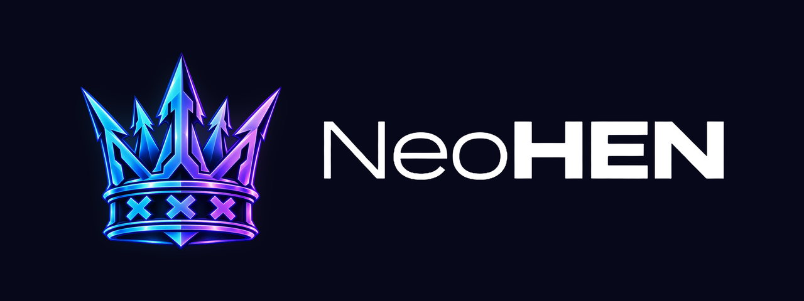

<p align="center">
  
</p>

<p align="center">
  <a href="README.md">English</a> · <b>Español</b>
</p>

# NeoHEN

NeoHEN es un habilitador de homebrew con Toolbox para consolas PS5 con
jailbreak. Se envía un solo fichero tras el exploit, `NeoHEN.elf`, y la
consola queda lista: Toolbox en el menú de inicio, montador de juegos, FTP,
DNS y un servicio remoto para paneles domésticos. Todo lo que arranca va
dentro de ese fichero; no hay nada que instalar.

Es un fork de [OnionHEN](https://github.com/aydencharles/onionHEN), de
aydencharles y colaboradores, que a su vez está construido sobre
[etaHEN](https://github.com/etaHEN/etaHEN), de LightningMods y colaboradores.
Casi todo lo que hace la Toolbox es trabajo suyo. NeoHEN añade las piezas de
la tabla de abajo y arregla lo que falló en la consola de su autor. Licencia
GPLv3.

> **Estado: versión candidata, probada en una sola consola.** NeoHEN se ha
> ejecutado en una única PS5 (CFI-7021, firmware 13.42). Todo lo que sigue
> indica si se vio funcionar ahí o si solo está compilado. Úsalo en una
> consola que puedas permitirte reiniciar.

## Qué cambia NeoHEN respecto a OnionHEN

| Área | NeoHEN |
|---|---|
| Reposo | La Toolbox vuelve sola cuando el menú lleva 30 s estable. El original la reinyecta a los 10 s de despertar, y en 13.42 eso reiniciaba el menú y lo dejaba bloqueado cerca de un minuto. Tres modos: `stable` (por defecto), `manual` y `original`. |
| Un solo fichero | `NeoHEN.elf` lleva dentro kstuff-lite, ShadowMount+, ftpsrv, nanoDNS y NeoWEB. En el primer arranque los escribe en `/data/neohen/payloads` y los lanza en orden; en los siguientes, solo los lanza. No hay que descargar, copiar ni renombrar nada. |
| Tú decides | Un payload que sustituyas o borres se queda como lo dejaste. Un `kstuff.elf` en `/data/neohen/` sustituye al que va dentro, y si ya hay un kstuff en marcha no se toca. |
| ShadowMount+ | Se usa el payload de su autor sin modificar, con un vigilante que comprueba su hook tras el reposo y cada 5 minutos, y puede relanzarlo. |
| NeoWEB | Servicio HTTP en la consola (puerto 8686) para paneles: temperaturas, discos, biblioteca con carátulas, juego abierto, lanzar y cerrar. Ver [web/README.md](web/README.md). |
| Privacidad | Los logs nunca llevan el nombre ni el identificador de la cuenta, y las IP y MAC se sustituyen. Los del original escriben nombre e identificador cada vez que se abre un menú. |
| Partición del sistema | El icono de la Toolbox vive en memoria volátil en vez de escribirse en `/system_ex`. |
| Descarga de trucos | Arreglado un caso en el que el botón no hacía nada al volver de otra página. |
| Valores seguros | Lo no verificado en 13.42 va oculto o apagado: superposición en partida, instalación de PKG desde la Toolbox, cargador de SPRX por juego, app jailbreak. |
| Marca | Nombre, rutas (`/data/neohen`), iconos y entrada de Ajustes, hechos con variables de compilación para que el fork siga pudiendo sincronizarse con el original. |
| Herramienta de PC | `neohen_pc` (rama `neohen/pc-tool`): comprueba la carpeta de un juego y la empaqueta como `.ffpfsc`, `.ffpfs`, `.exfat` o `.ffpkg`. |

El resto es OnionHEN: la Toolbox en 29 idiomas, trucos (JSON, SHN, MC4,
ShnExt), plugins, gestor de payloads, control del ventilador, emparejamiento
de Uso a distancia, atajos y opciones de juego. Su documentación está en
[docs/README-OnionHEN.md](docs/README-OnionHEN.md).

## Qué se ha probado

En una PS5 CFI-7021, firmware 13.42, con kstuff-lite 1.11 y ShadowMount+
1.7beta2.

| | Resultado |
|---|---|
| Arranque, Toolbox desde la tarjeta de inicio y desde Ajustes | Funciona (0.1.0-rc1) |
| Icono nuevo servido desde memoria volátil | Funciona (0.1.0-rc1) |
| Descarga del catálogo de trucos (6.231 ficheros) | Funciona (0.1.0-rc1) |
| Juegos montados por ShadowMount+ (`.ffpfsc`, uno de ellos AMPR) y homebrew | Funcionan (0.1.0-rc1) |
| Reposo con un juego suspendido, modos `manual` y `stable` | Funciona (0.1.0-rc1) |
| Recargar la Toolbox desde un PC (`neohen_ctl.py toolbox`) | Funciona (0.1.0-rc1) |
| Pasar desde un OnionHEN en marcha sin reiniciar | Funciona (0.1.0-rc1) |
| NeoWEB: estado, sensores, discos, biblioteca, carátulas, juego abierto | Funciona |
| Carga única en frío con arranque automático de payloads | **Sin probar** |
| Cambios de 0.1.0-rc2 (nombre en Ajustes, `stable` por defecto) | **Compilado, sin probar en consola** |
| NeoWEB: lanzar y cerrar un juego | **Sin probar** |
| El vigilante de ShadowMount+ recuperando un hook perdido | **Sin probar** |
| Aplicar un truco, instalar PKG, superposición, app jailbreak | **Sin probar** |
| Cualquier firmware distinto de 13.42 | **Sin probar** |

## En desarrollo

- **0.1.0-rc2** — compilada; pendiente de una prueba en frío en la consola.
- **NeoWEB** — la variante segura ya funciona; lo siguiente es probar
  lanzar y cerrar en consola, una página web a juego con esa variante, y las
  lecturas de energía, ventilador y M.2.
- **NeoAPP** — aplicación de PC sobre la variante completa de NeoWEB:
  subir juegos con transferencias reanudables, explorador de ficheros,
  biblioteca con carátulas, instalador, nombre, icono y fondo por juego, y
  temas. Sin empezar; la parte del servicio ya existe tras `make FULL=1`.
- **Perfiles por juego** — pausa de kstuff, plugins, trucos, parches, AMPR,
  umbral del ventilador y región en un mismo sitio.
- **Parches de juego** (FPS, resolución), repositorios de payloads con
  actualización y vuelta atrás, informe de diagnóstico y una combinación de
  botones de arranque seguro.

Problemas conocidos: la detección del conflicto con ps5upload no consigue
decidir en 13.42 (escribe `tracer state unknown`), así que no uses ps5upload
junto con la Toolbox; y el autopausado de kstuff de ShadowMount+ indica que
kstuff ya estaba desactivado, por una causa aún sin identificar.

## Descarga

Todavía no hay una versión pública en binario; la primera llegará tras la
prueba en frío de la 0.1.0-rc2. Mientras tanto:

- GitHub Actions compila cada rama. Abre la pestaña
  [Actions](../../actions), elige la última ejecución en verde de la rama que
  quieras y descarga su artefacto (GitHub pide haber iniciado sesión). Trae
  `NeoHEN.elf`, un zip con él y sus notas, y `SHA256SUMS`.
- O compílalo tú, ver [Compilar](#compilar).

## Instalación

No hay instalación.

1. Lanza el exploit hasta tener un cargador de ELF escuchando en el puerto
   9021.
2. Envíale `NeoHEN.elf`.

Eso es todo, en el primer arranque y en todos los demás. NeoHEN crea
`/data/neohen` en la consola, escribe ahí sus payloads la primera vez, y
arranca kstuff, la Toolbox, ShadowMount+, el servidor FTP, nanoDNS y NeoHEN
Web.

Dentro de `NeoHEN.elf`, sin modificar:

| Payload | Versión | Licencia |
|---|---|---|
| [ShadowMount+](https://github.com/drakmor/ShadowMountPlus) | 1.7beta2 | GPL-3.0 |
| [ftpsrv](https://github.com/ps5-payload-dev/ftpsrv) | v0.21.1 | GPL-3.0 |
| [nanoDNS](https://github.com/drakmor/nanoDNS) | 0.4 | GPL-3.0 |
| [kstuff-lite](https://github.com/EchoStretch/kstuff-lite) | v1.11 | sin declarar |

Son las versiones con las que se ha probado NeoHEN. Las tres primeras están
fijadas por URL y SHA-256 en `scripts/release/payloads.lock`.

Para cambiar algo, por FTP en `/data/neohen/payloads`:

- No arrancar uno: borra su fichero `.auto_start`.
- Quitar uno: borra su `.elf`. No vuelve a instalarse.
- Usar otra versión: sustituye el `.elf` y borra su fichero `.bundled`.
- Otro kstuff: deja un `kstuff.elf` en `/data/neohen/`.

No cargues a la vez etaHEN, OnionHEN ni CheatRunner. El zip de la versión
trae una guía más completa (`LEEME.txt`).

## Configuración

`/data/neohen/config.ini`, que se vuelve a leer con NeoHEN en marcha. Las
claves propias de NeoHEN:

```ini
[rest_mode]
toolbox_after_resume=stable   ; stable, manual, original
stable_seconds=30

[shadowmount]
watchdog=notify               ; off, notify, relaunch
watchdog_interval_seconds=300

[shellui]
wait_for_tracer=true

[home_screen]
system_ex_icon=false          ; true escribe el icono en /system_ex

[diagnostics]
kstuff_tables=false
```

Desde un PC de la misma red:

```sh
python3 scripts/neohen_ctl.py toolbox  <IP_PS5>   # cargar la Toolbox ahora
python3 scripts/neohen_ctl.py shutdown <IP_PS5>   # parar NeoHEN; kstuff sigue
```

Los logs están en `/data/neohen/`: `NeoHEN.log`, `NeoHEN_crash.log` y
`NeoHEN_util_daemon.log`.

## Compilar

```sh
./scripts/build-neohen.sh --release      # build/bin/NeoHEN.elf
make -C web                              # web/neoweb.elf
```

Los dos necesitan el [PS5 Payload SDK](https://github.com/ps5-payload-dev/sdk).
`.github/workflows/neohen-build.yml` es la referencia del entorno completo,
incluidas las librerías que el SDK no trae. `./scripts/build.sh` sigue
compilando un OnionHEN sin marca desde el mismo árbol.

## Repositorio

| Rama | Contenido |
|---|---|
| `neohen-main` | NeoHEN actual: 0.1.0-rc2 más NeoWEB |
| `neohen/release` | 0.1.0-rc1, la versión probada en consola |
| `neohen/pc-tool` | `neohen_pc`, el empaquetador de juegos |
| `neohen/docs` | Plan y procedimientos de prueba en consola |
| `main`, `dev` | OnionHEN original, sin tocar |

## Créditos

NeoHEN existe gracias al trabajo de otras personas.

- [OnionHEN](https://github.com/aydencharles/onionHEN) — aydencharles y
  colaboradores. La base directa de este fork.
- [etaHEN](https://github.com/etaHEN/etaHEN) — LightningMods y
  colaboradores. La base de OnionHEN.
- [ps5-payload-dev](https://github.com/ps5-payload-dev) — John Törnblom y
  colaboradores: SDK, elfldr y ftpsrv.
- [kstuff-lite](https://github.com/EchoStretch/kstuff-lite) — EchoStretch,
  sleirsgoevy y colaboradores.
- [ShadowMount+](https://github.com/drakmor/ShadowMountPlus),
  [nanoDNS](https://github.com/drakmor/nanoDNS) y
  [ampr_emu](https://github.com/drakmor/ampr_emu) — drakmor y colaboradores.
- [libhijacker](https://github.com/astrelsky/libhijacker) — astrelsky.
- [NineS](https://github.com/buzzer-re/NineS) — buzzer-re.
- [OnionBuddies](https://github.com/OnionBuddies) — SDK de plugins y plugins.
- [MkPFS](https://github.com/PSBrew/MkPFS) — usado por la herramienta de PC.

Los créditos completos del proyecto original están en
[docs/README-OnionHEN.md](docs/README-OnionHEN.md#credits).

## Licencia

GPLv3, igual que OnionHEN y etaHEN. Ver [LICENSE](LICENSE). Los componentes
de terceros conservan sus licencias. ShadowMount+, ftpsrv y nanoDNS son
GPL-3.0 y se redistribuyen sin modificar, con su código enlazado más arriba.
kstuff-lite no declara licencia; se incluye como lo hacen OnionHEN y etaHEN,
y se retirará si sus autores lo piden.

NeoHEN es para homebrew en consolas de tu propiedad. Se ofrece sin garantía.
